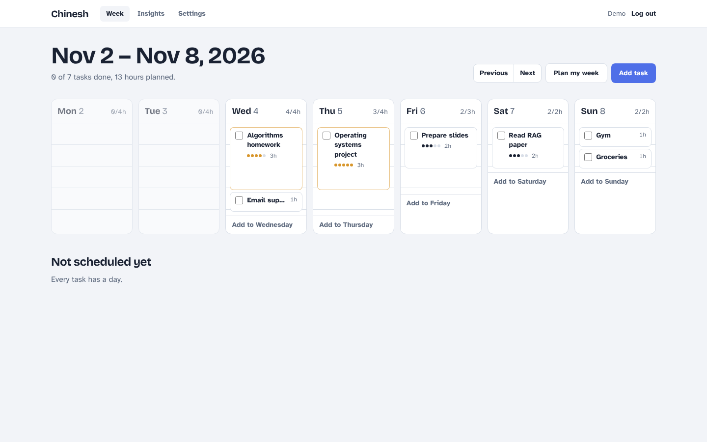
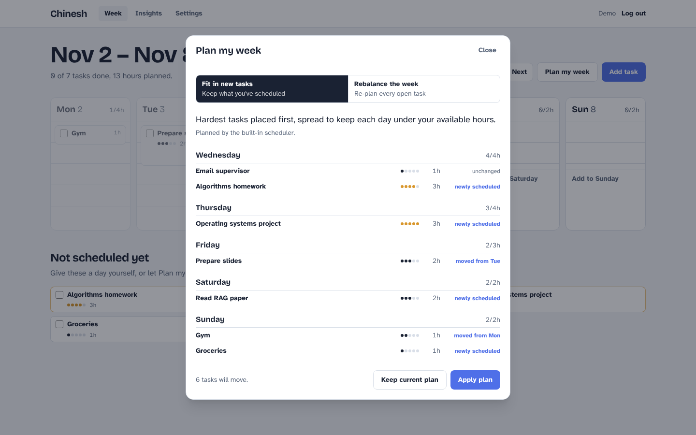
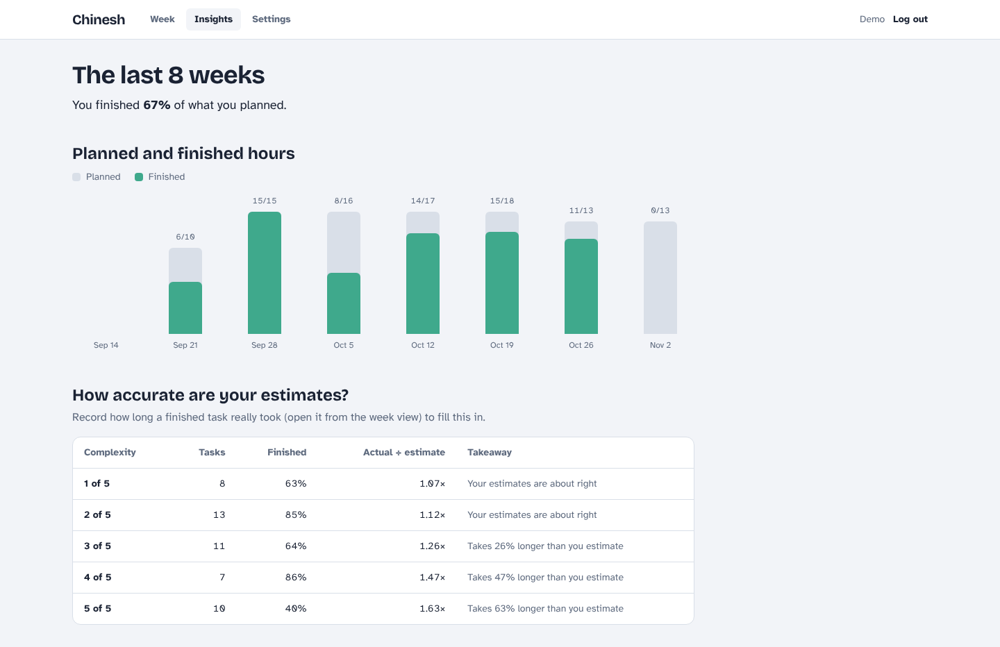
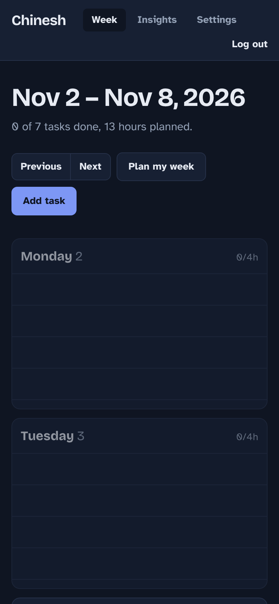

# Chinesh — weekly planner

Plan your week around the hours you actually have. You set how many hours each weekday really has, add tasks with an estimate and a difficulty, and the app fits them into the week without overbooking a day. An optional LLM planner proposes the schedule, but its output is validated against the same hard rules as the built-in scheduler before you ever see it.



**Stack:** Next.js 16 (App Router, route handlers) · TypeScript · PostgreSQL · Prisma 7 · Zod · Tailwind CSS 4 · Vitest · GitHub Actions

## Features

- **Accounts** — signup and login with bcrypt-hashed passwords and a signed, httpOnly session cookie. Every query is scoped to the logged-in user.
- **Weekly board** — each day is ruled one line per available hour and tasks are drawn as tall as their estimate, so a full or overbooked day is obvious at a glance.
- **Plan my week** — places unscheduled tasks (or re-plans the whole week) and shows a preview of every change before anything is saved.
- **LLM planning with guardrails** — any OpenAI-compatible API (OpenAI, OpenRouter, Groq, local Ollama). Invalid or rule-breaking answers fall back to the deterministic scheduler.
- **Insights** — planned vs finished hours per week and how far off your estimates are for each difficulty level, computed in SQL.
- Light and dark mode, keyboard accessible, works from phone to desktop.

| Plan preview | Insights | Mobile, dark |
| --- | --- | --- |
|  |  |  |

## How planning works

```
open tasks + hours left per day
        │
        ▼
LLM configured? ── no ──────────────────────────────────► greedyPlan()   source: "rules"
        │ yes
        ▼
ask model for JSON ─► parse with Zod ─► evaluatePlan()
        │                  │                 │
   timeout / HTTP     malformed         any violation ──► greedyPlan()   source: "fallback"
   error ─────────────────┴──────────────────┘
                                             │ none
                                             ▼
                                        LLM plan        source: "llm"
```

- **`greedyPlan`** (`src/lib/planner/greedy.ts`) places the hardest, longest tasks first, each on the open day with the most free hours, with a penalty for days that already carry hard work. Tasks that fit nowhere stay unscheduled instead of overbooking a day. It is deterministic, so it is easy to test.
- **`evaluatePlan`** (`src/lib/planner/evaluate.ts`) checks the hard rules (no overbooked days, no past days, every task exactly once, no unknown ids) and scores balance. Any plan, from any source, has to pass it.
- **Two modes.** *Fill* keeps tasks you already put on a day and plans around them. *Rebalance* re-plans every open task.
- **Nothing is saved until you apply it.** `POST /api/plan` returns a preview; `POST /api/plan/apply` writes all assignments in one transaction and rejects the whole batch if any task isn't yours.

`npm run eval:planner` runs both planners on fixed scenarios and prints a comparison:

```
┌─────────────────────┬─────────┬────────────┬───────────┬───────────┬────────────────┐
│ scenario            │ planner │ violations │ scheduled │ imbalance │ peakComplexity │
├─────────────────────┼─────────┼────────────┼───────────┼───────────┼────────────────┤
│ 'light week'        │ 'rules' │ 0          │ '5/5h'    │ 0.175     │ 3              │
│ 'exam week (tight)' │ 'rules' │ 0          │ '22/22h'  │ 0.219     │ 5              │
│ 'overbooked'        │ 'rules' │ 0          │ '15/18h'  │ 0         │ 5              │
│ 'mid-week start'    │ 'rules' │ 0          │ '12/12h'  │ 0.177     │ 4              │
└─────────────────────┴─────────┴────────────┴───────────┴───────────┴────────────────┘
```

## API

All endpoints return JSON. Errors have one shape: `{ "error": { "code", "message", "details"? } }`.

| Method | Path | Description |
| --- | --- | --- |
| `POST` | `/api/auth/signup` | Create an account and start a session |
| `POST` | `/api/auth/login` | Start a session |
| `POST` | `/api/auth/logout` | End the session |
| `GET` / `PATCH` | `/api/me` | Profile / update hours available per weekday |
| `GET` | `/api/tasks?week=YYYY-MM-DD` | Tasks for a week (any date resolves to its Monday) |
| `POST` | `/api/tasks` | Create a task |
| `PATCH` / `DELETE` | `/api/tasks/:id` | Update (title, hours, complexity, day, done, actualHours) / delete |
| `POST` | `/api/plan` | Preview a plan: `{ week?, mode?: "fill" \| "rebalance" }` |
| `POST` | `/api/plan/apply` | Save a plan atomically |
| `GET` | `/api/insights?weeks=8` | Completion trend and estimate accuracy |
| `GET` | `/api/health` | Liveness and database check |

Design notes:

- **Validation at the edge.** Every body and query goes through a strict Zod schema; unknown fields are rejected rather than ignored, so a client can't sneak in a `userId`.
- **Ownership checks return 404, not 403**, so task ids can't be probed across accounts.
- **Login doesn't leak which emails exist** — unknown email and wrong password produce the same response and comparable timing (a bcrypt comparison runs either way).
- **Rules live in the database too.** Hours, difficulty and day ranges are `CHECK` constraints in the migration, not just in the API.
- **Insights are aggregated in SQL** (`FILTER`, `generate_series` so empty weeks still appear) instead of loading every task into Node.

## Project structure

```
prisma/
  schema.prisma          User and Task models
  migrations/            SQL migrations (with CHECK constraints)
  seed.ts                demo account with 6 weeks of history
src/
  app/api/               route handlers: parse input, call a service, return JSON
  app/(auth)/            login and signup pages
  app/(app)/             signed-in pages: week board, insights, settings
  server/                services: all database access, always scoped by user id
  lib/planner/           greedy scheduler, plan evaluator, LLM client
  lib/auth/              password hashing and session tokens
  lib/validation.ts      Zod schemas for every request
tests/                   Vitest: unit tests + API tests against a real Postgres
scripts/eval-planner.ts  planner comparison
```

## Running locally

Requirements: Node 22+ and Docker (or any PostgreSQL 16).

```bash
cp .env.example .env          # then set SESSION_SECRET (openssl rand -base64 32)
docker compose up -d          # Postgres with "planner" and "planner_test" databases
npm install                   # also generates the Prisma client
npm run db:deploy             # apply migrations
npm run db:seed               # optional: demo@chinesh.app / demo-password
npm run dev                   # http://localhost:3000
```

To enable LLM planning, set `LLM_BASE_URL`, `LLM_API_KEY` and `LLM_MODEL` in `.env`. Without them the app uses the built-in scheduler.

| Script | What it does |
| --- | --- |
| `npm test` | Unit and API tests (uses `TEST_DATABASE_URL`, which it wipes) |
| `npm run lint` / `npm run typecheck` | ESLint / TypeScript |
| `npm run eval:planner` | Compare planners on fixed scenarios |
| `npm run db:migrate` | Create a new migration after changing the schema |

CI runs migrations, checks they match the Prisma schema, then lint, typecheck, tests and a production build on every push and pull request.

## Deploying

Works on Vercel with any hosted Postgres (Neon, Supabase). Set `DATABASE_URL`, `SESSION_SECRET` and optionally the `LLM_*` variables. The `vercel-build` script applies pending migrations before building.

## Known limitations

- Login has no rate limiting yet. On serverless an in-memory limiter wouldn't hold across instances; the right fix is a shared store such as Redis.
- Weeks are computed in UTC, so "today" can be off by a few hours near midnight in time zones far from UTC.
- Sessions are stateless JWTs, so logging out clears the cookie but a copied token stays valid until it expires (7 days).
